<div align="center">

# 汉语搭子

**课后陪练 · 每天一刻钟**

给在北京语言大学学中文的留学生，做一个**下课之后还愿意打开**的中文练习场

手机端优先 · 打开链接就能练 · 和同学 PK 连注册都不用

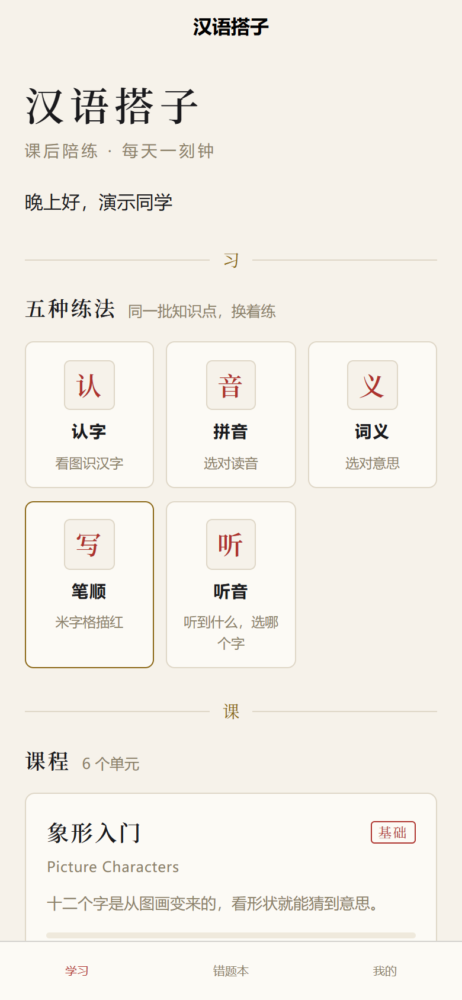 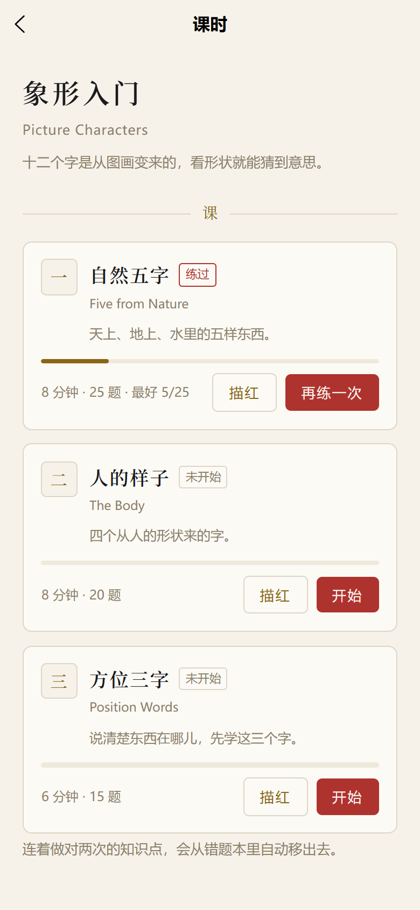 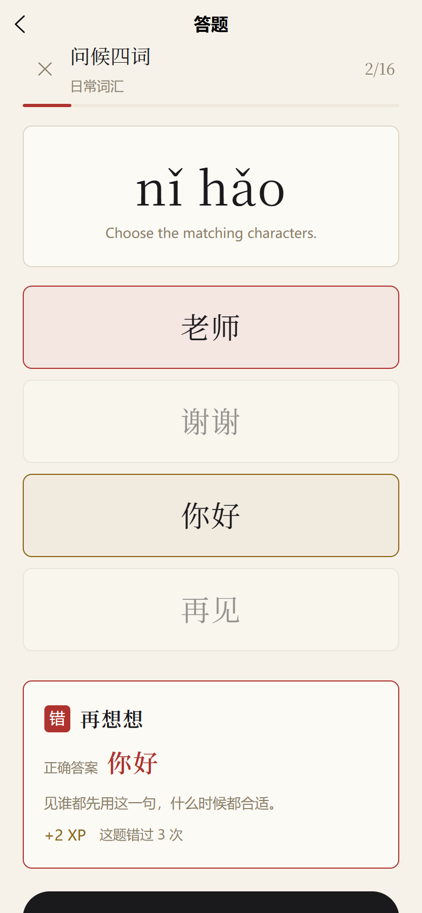

</div>

---

## 一、同类软件缺的，正好是「课后」那一段

学中文的人手机里通常已经躺着好几个 App 了。真正卡住他们的从来不是「没东西学」，而是下面这七件事：

| # | 你大概遇到过 | 汉语搭子怎么做 |
|:--:|---|---|
| 1 | **课上完了，没人管你练没练。** 网课把新知识讲给你，然后就没有然后了 | 只做**课后那一段**：不教新课，把你课上刚学过的练到手上。一天一刻钟，练完就走 |
| 2 | **会认不会写。** 中文最特殊的一关是笔顺和字形，背单词式的 App 根本不管 | **米字格描红**：28 个常用字带笔顺演示，写不出来也有台阶下，不算你错 |
| 3 | **练完就忘。** 同一个词只有一种题型见过一次，考试换个问法就不认识了 | 同一批知识点用**五种练法**轮着来：认字 / 拼音 / 词义 / 笔顺 / 听音 |
| 4 | **答错只告诉你「错了」。** 不告诉你为什么错，更不说下一步该练什么 | 错题自动进**错题本**，并给出**错因诊断 + 行动处方**（见第五节） |
| 5 | **断签清零、掉段位。** 游戏化变成了压力来源，练三天断一天就前功尽弃 | **奖励，但不惩罚**：答错也给经验，断签不清零，段位只升不降 |
| 6 | **一个人练不下去。** 没有同学、没有对手、没有观众 | 8 人学习小组 + **免注册的异步 PK** + 每周排行榜 |
| 7 | **界面全是英文。** 中文学习者母语不一定是英语，提示看不懂就没法练 | 选择题配一句英文提示（`Choose the correct pinyin.`），单元名中英双标 |

> ### 别人卖课，我们做课后陪练。

---

## 二、五种练法：同一批知识点，换着练

学一个「日」字，不是只做一道选择题就完事——**认、音、义、写、听**五种问法轮着上，直到它变成条件反射。

声调还单独拎出来做一课：**同一个 ma，四个声调就是四个字**——妈 mā / 麻 má / 马 mǎ / 骂 mà。

<div align="center">
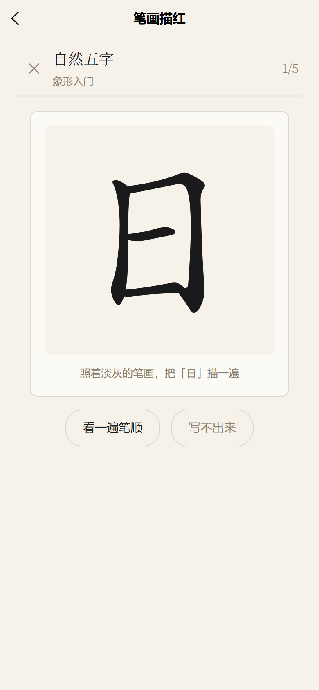
</div>

答错的那一刻，才是真正学到东西的时候：页面会立刻给出**正确答案 + 字源解释**。

> 「日」——太阳的样子，中间那一点是它的光。

一次答错**照样给 2 点经验**。这里的设计原则是：**做错不该被惩罚，做错该被解释清楚。**

---

## 三、中文独有的那一关：写不好字

拼音、词义可以靠选择题；**笔顺不行**。

- **米字格描红**，照着淡灰的笔画一笔一笔描，写错了随时重来
- **「看一遍笔顺」**：卡住的时候可以先把这个字看一遍再动手
- **「写不出来」**：承认不会也是一种答案，点它就当场看解法。这一题**诚实地记错、进错题本**，下次再来——不假装你写对了
- **不用笔迹识别打分**：写完点「我写好了」即可。这一版**不假装能判断你写得好不好**，只负责让你把这个字写一遍
- 覆盖 **28 个字**：从象形字（日 月 山 水 火 人 大 小 上 下 中 口）到偏旁字（河 海 洗 汉 树 林 桌 校 打 找 拉 拿）

这一关，市面上的中文 App 大多直接跳过。而它恰恰是留学生写汉字最疼的地方。

---

## 四、错题本：不只告诉你错了，还告诉你为什么

<div align="center">
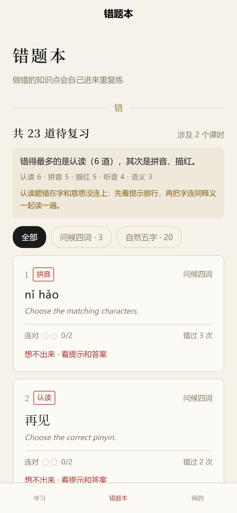
</div>

错题本不是简单地把错题堆在一起，而是**先诊断，再开药**：

- **算总账**：共 23 道待复习，涉及 2 个课时
- **找规律**：错得最多的是认读（6 道），其次是拼音、描红 ｜ 认读 6 · 拼音 5 · 描红 5 · 听音 4 · 语义 3
- **给处方**：「认读题错在字和意思没连上：先看提示那行，再把字连同释义一起读一遍。」
- **记掌握度**：每个知识点挂着「连对 ○○ 0/2」——**连续答对 2 次才算真的会了**，否则它会一直回来找你
- **可按课时分组**：全部 / 问候四词 · 3 / 自然五字 · 20

---

## 五、奖励，但不惩罚

游戏化的部分刻意做「轻」——它是为了让练习有个落脚点，不是为了拴住你。

<div align="center">
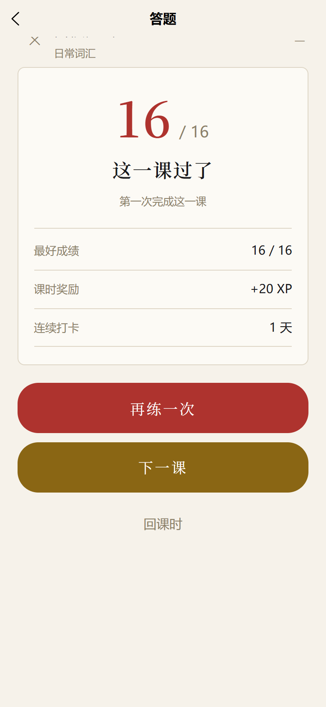 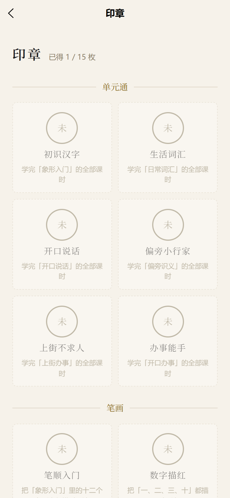 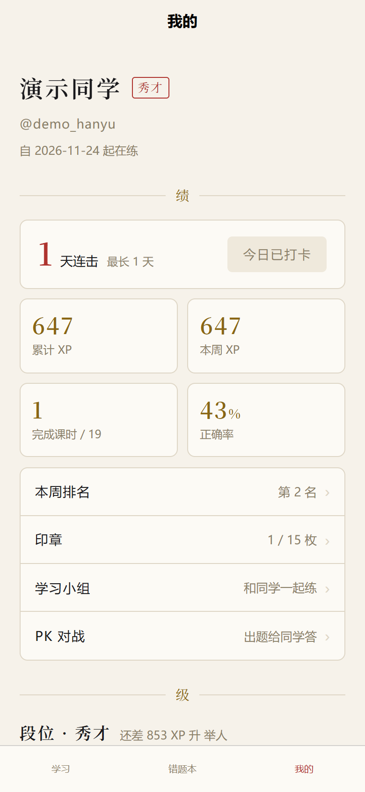
</div>

| 机制 | 规则 |
|---|---|
| **经验** | 答对 **+10**，答错 **+2**，完成一个课时 **+20**，每天打卡 **+5** |
| **科举段位** | 童生 → 秀才（500）→ 举人（1500）→ 贡士（3000）→ 进士（6000） |
| **15 枚印章** | 单元通关 ×6、笔顺成就 ×3、连续打卡 ×3（3 / 7 / 14 天）、经验里程 ×3 |
| **课时门槛** | 正确率过六成即算「这一课过了」，不必满分也能推进 |
| **不惩罚** | 断签只把连击天数归 1——经验、段位、已解锁的内容一律不收回。今天没来，明天接着练 |

---

## 六、一个人练不下去，那就拉上同学

<div align="center">
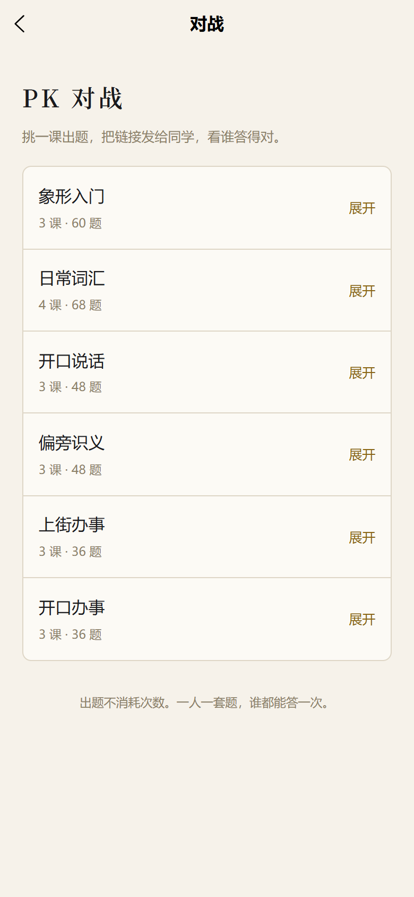 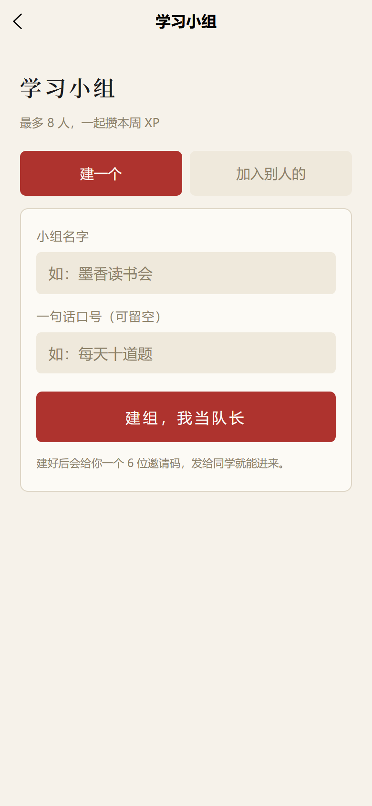
</div>

- **学习小组**：最多 8 人一起攒本周经验，建组后拿到 **6 位邀请码**（字符集刻意去掉了 `0 O 1 I`，念给同学听不会听错）
- **异步 PK**：挑一个单元出题，把链接发给同学，**对方不注册也能作答**——先把人拉进来，再谈注册
- **周榜**：每周一零点切榜，比的是这一周的投入，不是历史总账。新同学第一周就有机会上榜

---

## 七、内容清单

| 单元 | Unit | 课时 | 题量 |
|---|---|:--:|:--:|
| 象形入门 | Picture Characters | 4 | 72 |
| 日常词汇 | Everyday Words | 4 | 68 |
| 开口说话 | Start Speaking | 3 | 48 |
| 偏旁识义 | Radicals | 3 | 48 |
| 上街办事 | Out and About | 3 | 36 |
| 开口办事 | Getting Things Done | 3 | 36 |
| **合计** | | **20** | **308** |

- **80 个知识点 / 308 道题 / 40 段录音 / 28 个描红字 / 15 枚印章 / 5 级段位**
- 全部题目自带题型标签（认读 / 拼音 / 词义 / 笔顺 / 听音），错题本能据此做归因

---

## 八、v1 明确不做什么

边界画清楚，比堆功能更说明问题：

- ❌ **实时对战** —— 异步 PK 已经够用，实时对战要长连接和断线重连，性价比低
- ❌ **语音识别打分** —— 「说」这一练法依赖发音评测，v1 先用**听音**顶上
- ❌ **私信聊天** —— 私信背后是内容审核、举报与封禁，这套成本不该由作品项目背包袱
- ❌ **支付、教师端、班级管理** —— 这一版只回答一个问题：**课后陪练做不做得动**

---

## 九、设计与技术

界面刻意避开了「在线教育」那套蓝紫渐变：

- **宣纸底** `#F6F2EA` · **朱砂红** `#AE332E` · 深色**墨底金线**
- 每个单元配一句人话简介，比如象形入门：「十二个字是从图画变来的，看形状就能猜到意思。」
- 选择题都配一句英文提示，照顾母语非英语的学习者

技术栈：

```
前端   uni-app（Vue3 + TypeScript + Vite）→ H5，手机端优先，13 个页面
后端   Express + SQLite（Knex 迁移 + better-sqlite3）
跑法   npx tsx 直接起，前端 /api 反向代理到后端
```

本地跑起来：

```bash
# 后端（默认 8091）
cd server && npm install && npm run dev

# 前端（Vite 开发服务器，/api 代理到后端）
cd mobile && npm install && npm run dev:h5
```

---

## 十、这个项目是怎么做出来的

五天，从一份方案书到一个能点开就练的完整产品，用的是「一轮四拍」的节奏：

**① 并行功能波 → ② 冻结 → ③ 非作者验收波 → ④ 串行部署波**

21 个可验收单元分四条泳道推进（后端接口 / 学习功能 / 游戏化 / 内容）。只有**非作者本人亲自跑过断言**的单元才允许被标记为「已验收」——自己写的东西自己说通过，不算数。

想看得更深：

| 文档 | 内容 |
|---|---|
| [`plan.html`](plan.html) | 完整方案书：需求、取舍、数据模型、排期、答辩预案 |
| [`CONTRACT.md`](CONTRACT.md) | 验收契约：每个单元的断言与判据 |
| [`PLAN/`](PLAN/) | 四条泳道的逐轮状态与原始读数 |

---

<div align="center">
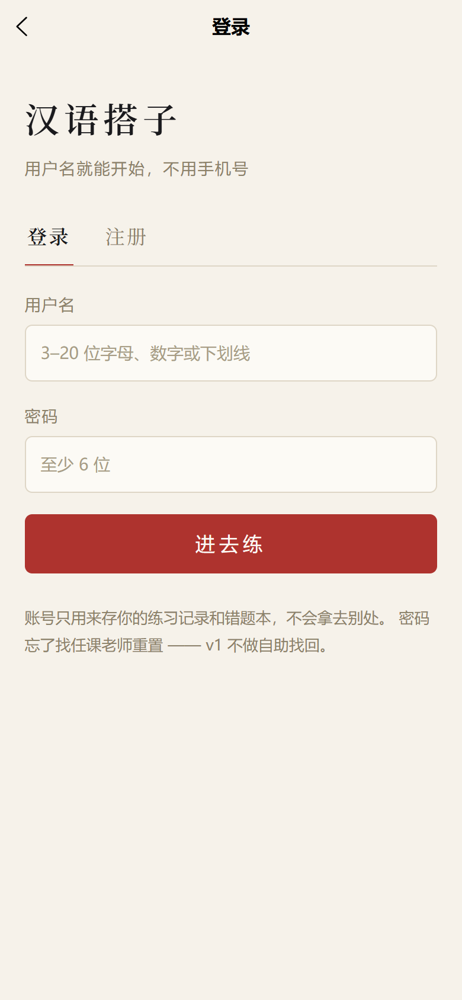

**汉语搭子** · 课后陪练，每天一刻钟

</div>
